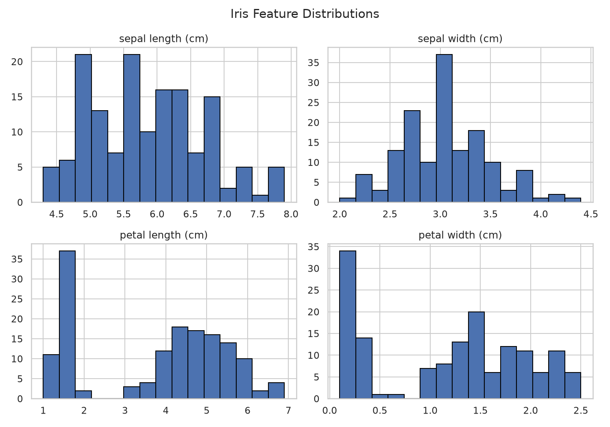
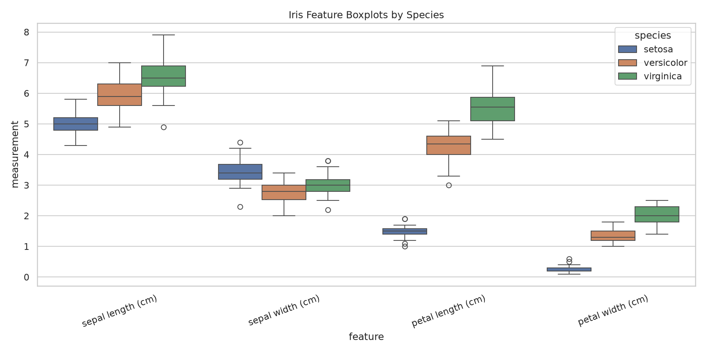
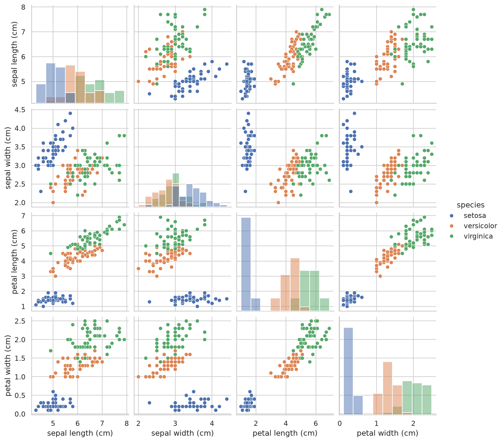
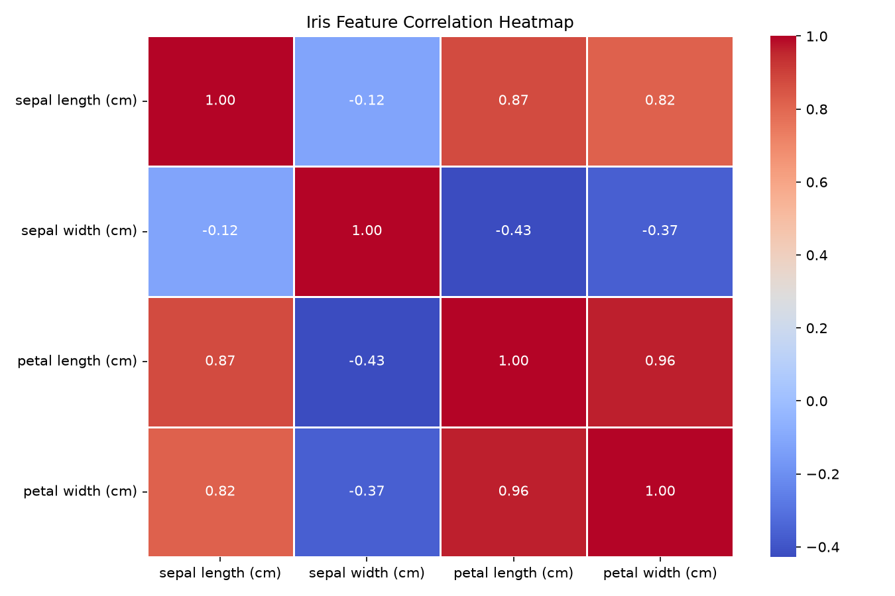

# Iris Flower Classification

## 1. Project Overview

This project uses Machine Learning to classify Iris flowers into three species based on their physical measurements.

Species:
- Setosa
- Versicolor
- Virginica

Completed as part of the Oasis Infobyte Data Science Internship (OIBSIP).

## 2. Dataset

Dataset: Scikit-learn Iris dataset.

- Total observations: 150
- Input features: 4
- Target classes: 3
- Samples per class: 50

### Input Features
1. Sepal length (cm)
2. Sepal width (cm)
3. Petal length (cm)
4. Petal width (cm)

## 3. Technologies

- Python
- NumPy
- Pandas
- Matplotlib
- Seaborn
- Scikit-learn
- Joblib

## 4. Project Workflow

1. Dataset loading and inspection
2. Exploratory Data Analysis
3. Missing-value analysis
4. Data visualization
5. Correlation analysis
6. Model training and comparison
7. Stratified 5-fold cross-validation
8. Final test evaluation
9. Model saving using Joblib
10. Prediction using new measurements

## 5. Machine Learning Models

Three algorithms were evaluated:

- Logistic Regression
- K-Nearest Neighbors (KNN)
- Random Forest

### Cross-Validation Results

| Model | Mean CV Accuracy | Standard Deviation |
|---|---:|---:|
| Logistic Regression | 95.83% | 2.64% |
| KNN | 95.83% | 2.64% |
| Random Forest | 95.00% | 3.12% |

Logistic Regression was selected. It tied with KNN for the highest mean cross-validation accuracy.

### Final Test Results

- Training/testing split: 80% / 20%
- Test samples: 30
- Random state: 42
- Final test accuracy: 93.33%
- Selected model: Logistic Regression

## 6. Project Structure

```text
DataScience-Task1-IrisFlowerClassification/
├── screenshots/
│   ├── 01_histograms.png
│   ├── 02_boxplots.png
│   ├── 03_pairplot.png
│   └── 04_correlation_heatmap.png
├── correlation_analysis.py
├── cross_validation.py
├── generate_eda_charts.py
├── train_models.py
├── predict_iris.py
├── iris_model.pkl
├── model_comparison.csv
├── requirements.txt
├── README.md
└── .gitignore
```

## 7. Installation

Create and activate a virtual environment:

```bash
python3 -m venv .venv
source .venv/bin/activate
```

Install dependencies:

```bash
pip install -r requirements.txt
```

## 8. Run the Project

Generate EDA charts:

```bash
python generate_eda_charts.py
```

Run correlation analysis:

```bash
python correlation_analysis.py
```

Train and compare models:

```bash
python train_models.py
```

Run cross-validation and save the selected model:

```bash
python cross_validation.py
```

Run the prediction program:

```bash
python predict_iris.py
```

## 9. Saved Model

The `iris_model.pkl` file contains the fitted Scikit-learn pipeline, including StandardScaler and Logistic Regression.

The prediction program loads this model without retraining.

## 10. Example Prediction

Input measurements:

- Sepal length: 5.1 cm
- Sepal width: 3.5 cm
- Petal length: 1.4 cm
- Petal width: 0.2 cm

Predicted species: Setosa

## 11. EDA Visualizations

### Histograms


### Boxplots


### Pairplot


### Correlation Heatmap


## 12. Conclusion

This project demonstrates an end-to-end Machine Learning classification workflow, from data exploration and model evaluation to model serialization and predictions on new flower measurements.
