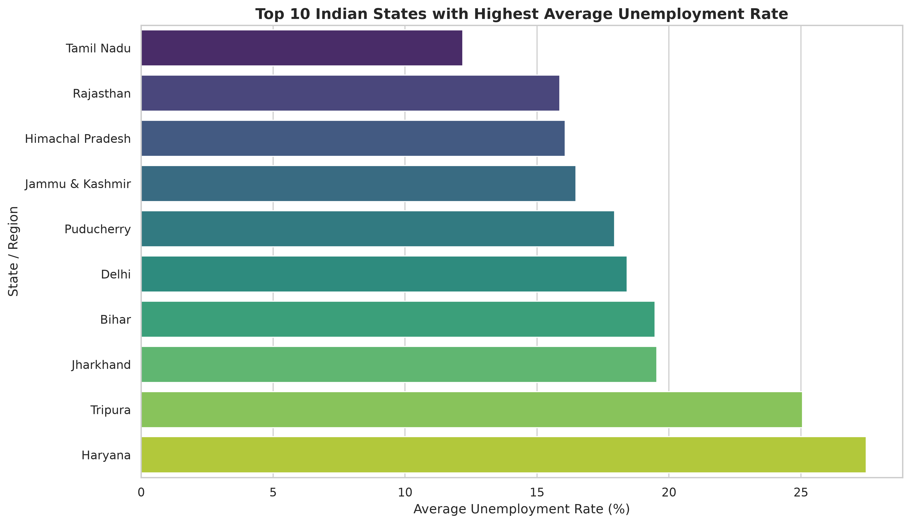
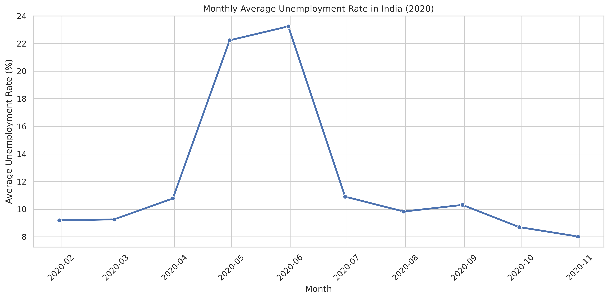
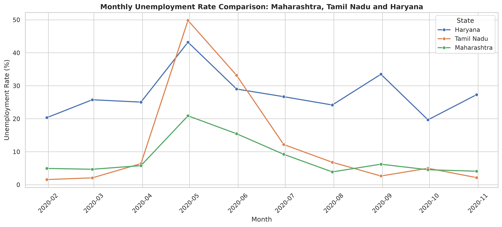
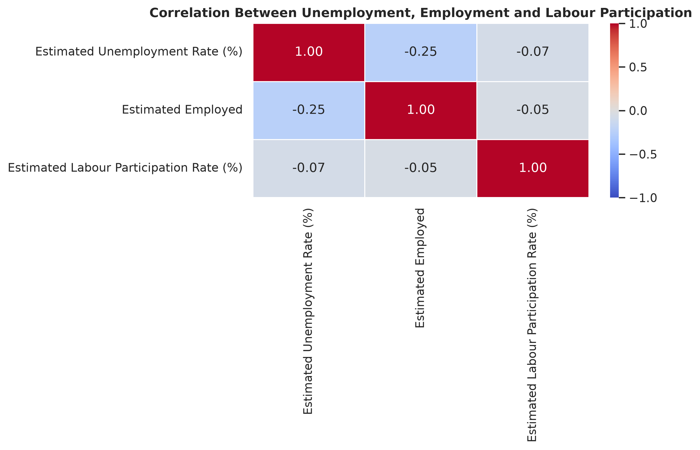
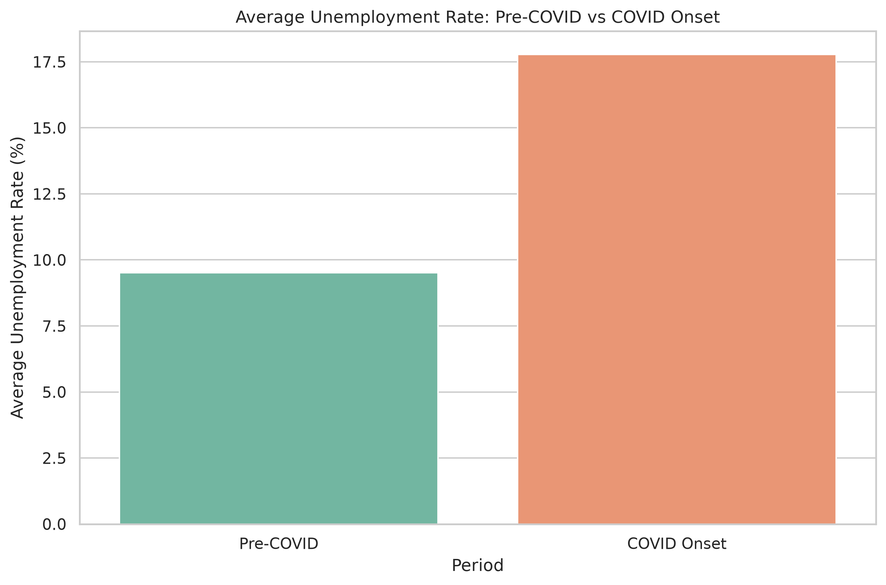
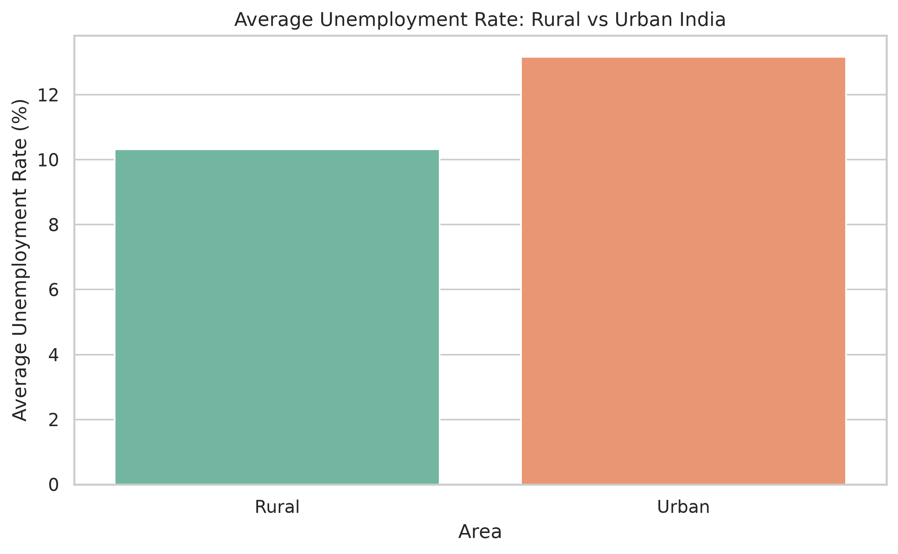

# Unemployment Analysis in India

## Project Overview

This project explores unemployment trends in India using Python, Pandas and data visualization techniques. It examines state-wise unemployment rates, monthly trends, rural and urban differences, and changes during the initial COVID-19 period.

Completed as part of the **Oasis Infobyte Data Science Internship (OIBSIP)**.

## Objectives

- Analyse unemployment rates across Indian states.
- Examine monthly unemployment trends.
- Compare unemployment rates across selected states.
- Study correlations between unemployment, employment and labour participation.
- Compare pre-COVID and initial COVID-period unemployment.
- Explore rural and urban unemployment differences.

## Technologies Used

- Python
- Pandas
- NumPy
- Matplotlib
- Seaborn
- Jupyter Notebook

## Project Structure

```text
DataScience-Task2-UnemploymentAnalysis/
├── dataset/
│   ├── Unemployment in India.csv
│   └── Unemployment_Rate_upto_11_2020.csv
├── notebooks/
│   └── 01_unemployment_eda.ipynb
├── screenshots/
│   ├── top_10_unemployment_states.png
│   ├── monthly_unemployment_trend.png
│   ├── statewise_unemployment_trends.png
│   ├── unemployment_correlation_heatmap.png
│   ├── pre_covid_vs_covid_comparison.png
│   └── rural_vs_urban_unemployment.png
├── README.md
└── requirements.txt
```

## Dataset Information

Two datasets were analysed separately:

**Dataset A — Unemployment in India**
- Original records: 768
- Records after removing completely empty rows: 740
- Regions: 28
- Coverage: May 2019 to June 2020
- Includes rural and urban observations.

**Dataset B — Unemployment Rate up to November 2020**
- Records: 267
- Regions: 27
- Coverage: January 2020 to October 2020

The datasets were not directly combined because their structures and observation coverage differ.

## Analysis Performed

1. Dataset loading, inspection and cleaning.
2. Descriptive statistical analysis.
3. State-wise average unemployment analysis.
4. Top 10 states by average unemployment rate.
5. Monthly unemployment trend analysis.
6. Time-series comparison of Maharashtra, Tamil Nadu and Haryana.
7. Correlation analysis of unemployment, employment and labour participation.
8. Pre-COVID vs initial COVID-period comparison.
9. Rural vs urban unemployment comparison.

## Visualizations

### Top 10 States by Average Unemployment Rate



### Monthly Unemployment Trend



### State-wise Unemployment Trends



### Correlation Heatmap



### Pre-COVID vs COVID-Onset Comparison



### Rural vs Urban Comparison



## Key Findings

- Unemployment varied considerably across states.
- The monthly average unemployment rate increased sharply in April and May 2020, reaching approximately 22.24% and 23.24%, respectively, in Dataset B.
- The highest state-wise average unemployment rates in Dataset B were observed in Haryana (27.48%), Tripura (25.06%) and Jharkhand (19.54%).
- Selected states showed different unemployment trends over the observed period.
- The correlation analysis explored relationships among unemployment, employment and labour participation.
- The pre-COVID and initial COVID-period comparison highlighted changes during the early pandemic.
- Rural and urban observations showed differences in average unemployment rates.

## Important Analytical Notes

- Dataset A was used for the rural/urban comparison and pre-COVID vs initial COVID-period analysis.
- Dataset B was used for state-wise rankings, monthly trends and correlation analysis.
- Pre-COVID refers to May 2019–February 2020; the initial COVID period refers to March–June 2020 in Dataset A.
- Monthly and state-wise averages are simple averages of available observations, not official population-weighted national estimates.
- The dataset's monthly coverage is uneven across regions, which should be considered when interpreting comparisons.

## Conclusion

This project demonstrates how Python-based exploratory data analysis can help identify unemployment patterns, regional differences and changes during the early COVID-19 period. Visualizations and statistical summaries make the findings easier to interpret.

## Internship

- Organization: Oasis Infobyte
- Program: Data Science Internship
- Task: Unemployment Analysis in India

---

Developed using Python and data analysis libraries.