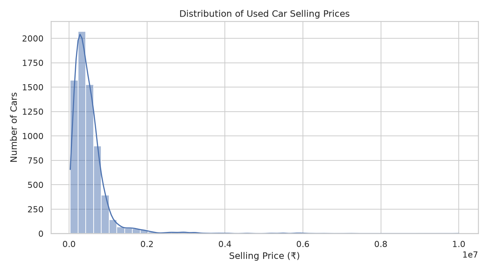
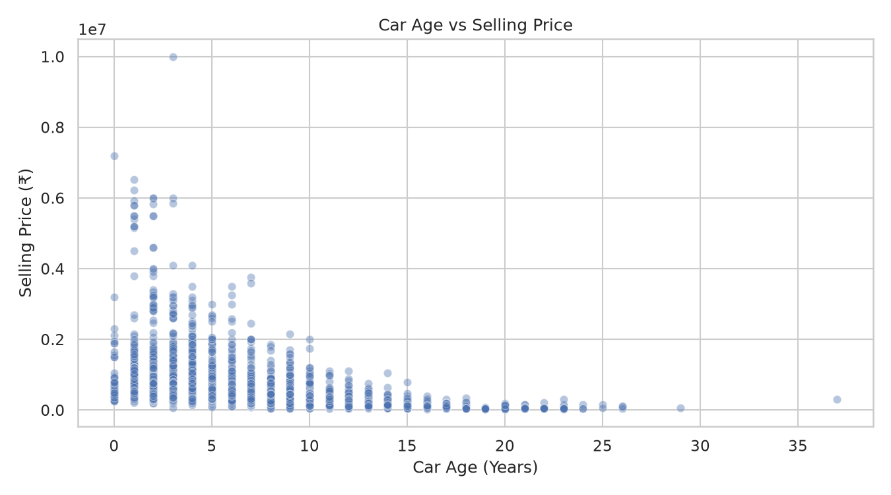
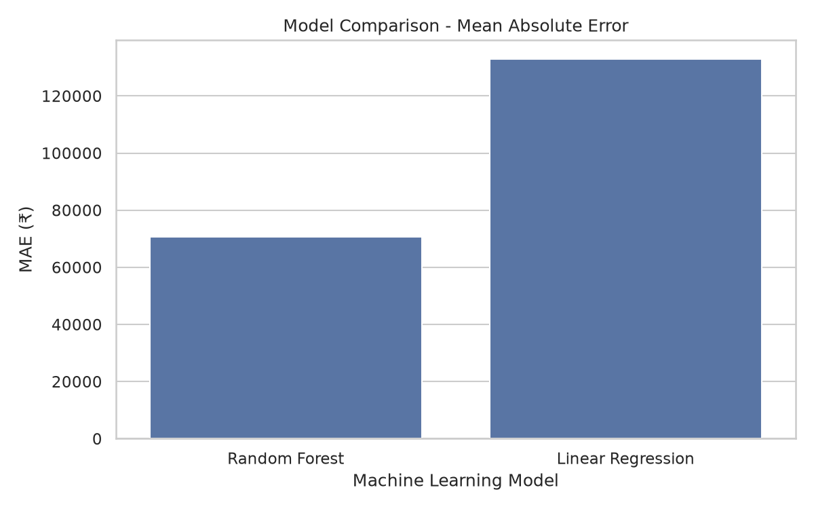
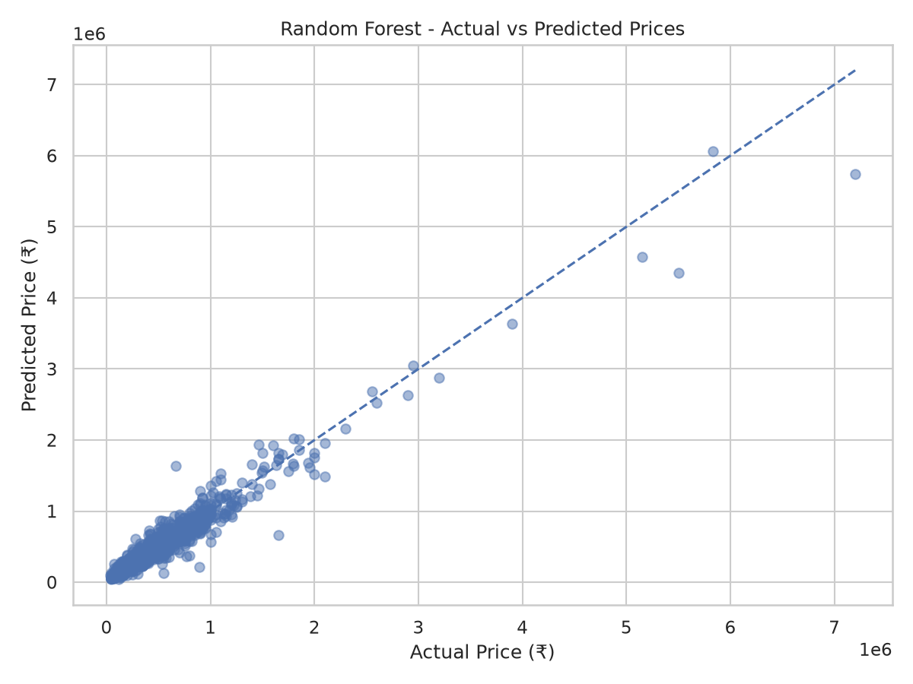

# Used Car Price Prediction with Machine Learning

## Overview

This project develops a regression model to estimate used-car selling prices using historical CarDekho vehicle data. It covers data cleaning, exploratory data analysis, feature engineering, model comparison, evaluation and prediction through a saved machine-learning pipeline.

## Objectives

- Clean and prepare raw vehicle data.
- Explore relationships between vehicle attributes and selling prices.
- Engineer useful numerical and categorical features.
- Compare regression models using test-set metrics.
- Save the selected model and use it for new predictions.

## Dataset

- **Source file:** `Car details v3.csv`
- **Original records:** 8,128
- **Records after exact duplicate removal:** 6,926
- **Target variable:** `selling_price`

The dataset contains vehicle details such as name, year, kilometres driven, fuel, transmission, ownership and technical specifications.

## Data Cleaning and Feature Engineering

The cleaning workflow includes:

- Removing exact duplicate records.
- Extracting numerical values from mileage, engine, power and torque fields.
- Separating mileage value from its unit.
- Converting torque values expressed in kgm to Nm using the conversion factor 9.80665.
- Treating ambiguous torque units as missing rather than assuming a conversion.
- Deriving `car_age` using the dataset reference year: `2020 - year`.
- Extracting the vehicle brand from the first word of the car name.

The model uses 13 features: `brand`, `car_age`, `km_driven`, `mileage_value`, `mileage_unit`, `engine_cc`, `max_power_bhp`, `torque_nm`, `seats`, `fuel`, `transmission`, `seller_type` and `owner`.

## Exploratory Data Analysis

The notebook explores selling-price distributions, vehicle age, and relationships between features and prices.

### Visualizations

## Model Development

The dataset was divided into training and testing sets:

- Training: 5,540 records (80%)
- Testing: 1,386 records (20%)
- Random state: 42

A preprocessing pipeline was used:

- Numerical features: median imputation and standard scaling.
- Categorical features: most-frequent imputation and one-hot encoding.
- A ColumnTransformer combines both preprocessing workflows.
- Preprocessing is fitted on training data only to avoid data leakage.

## Models and Results

Two regression models were compared on the held-out test set.

| Model | MAE (₹) | RMSE (₹) | R² |
|---|---:|---:|---:|
| Linear Regression | 132,937.49 | 261,730.89 | 0.6877 |
| Random Forest | 70,780.51 | 116,786.50 | 0.9378 |

Random Forest performed better across all three reported metrics and was selected as the final model.

**Note:** R² is a regression evaluation metric, not classification accuracy.

## Saved Model

The selected preprocessing and prediction pipeline is saved at:

`models/car_price_model.pkl`

The pipeline can be loaded by the standalone prediction script.

## How to Run

Run these commands from the project directory:

    cd DataScience-Task3-CarPricePrediction
    source ../.venv/bin/activate
    python -m pip install -r requirements.txt

Clean the dataset:

    python scripts/clean_data.py

Open the notebook:

    jupyter notebook notebooks/01_car_price_eda.ipynb

Generate a prediction:

    python scripts/predict_car_price.py

## Sample Prediction

An illustrative Maruti Swift input produced the following estimated selling price:

**₹609,448.30**

This is a model-generated estimate, not a guaranteed market valuation or an actual vehicle quotation.

## Limitations

- The model is based on historical data and may not reflect current market prices.
- Vehicle condition, accident history, service records and local market demand are not directly represented.
- Brand extraction uses the first word of the vehicle name, which may not correctly represent every multi-word manufacturer.
- Missing or ambiguous technical specifications can affect prediction quality.
- Realistic input validation does not guarantee that every combination of vehicle specifications exists in the market.

## Conclusion

This project demonstrates an end-to-end regression workflow, including data cleaning, exploratory analysis, feature engineering, preprocessing, model comparison, evaluation, pipeline persistence and standalone prediction.
