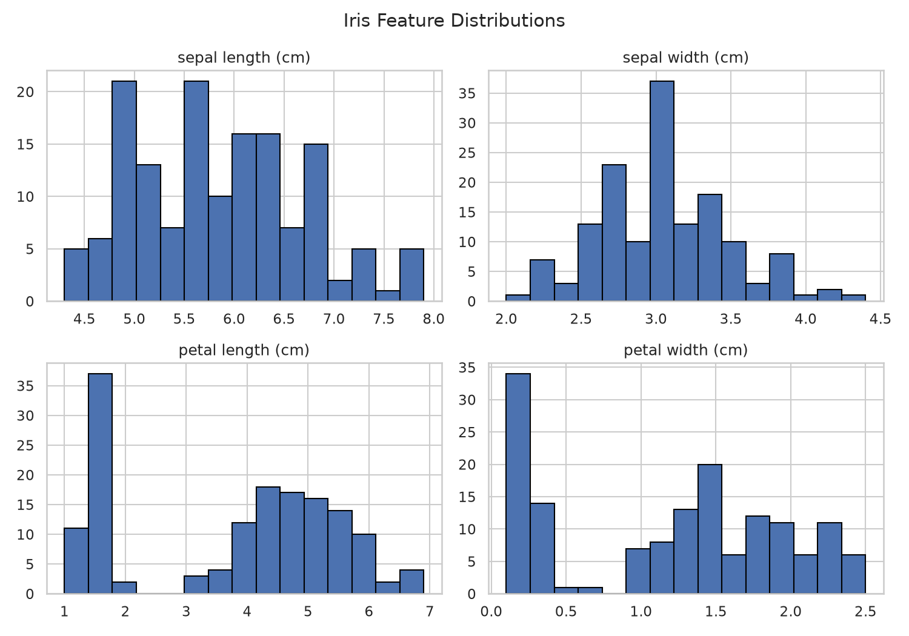
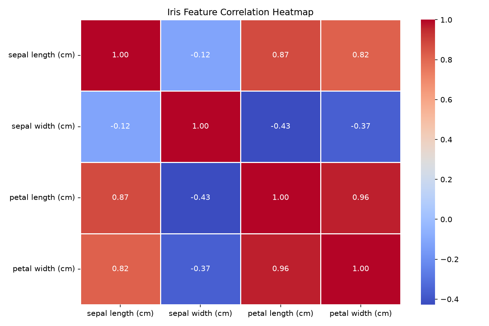
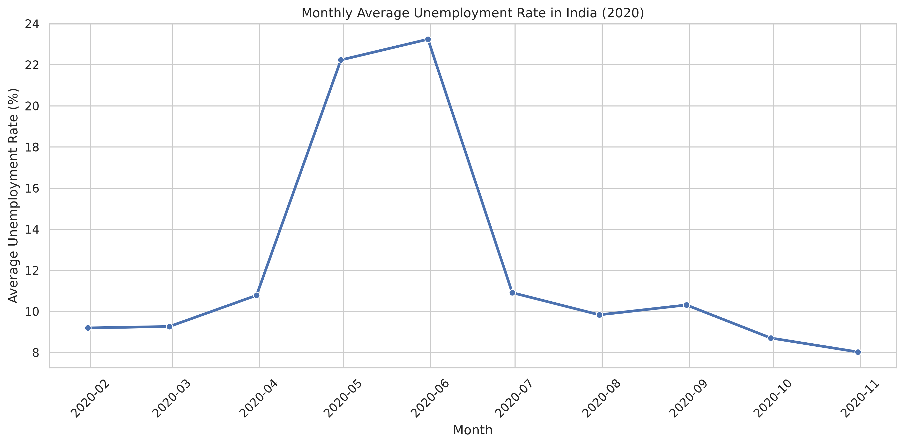
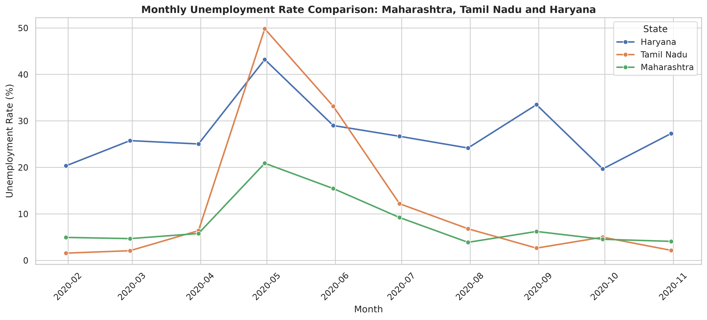
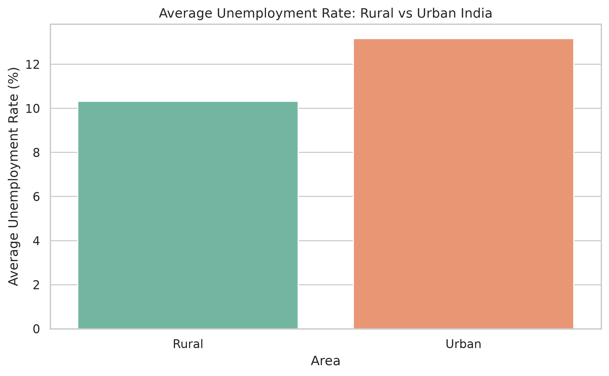
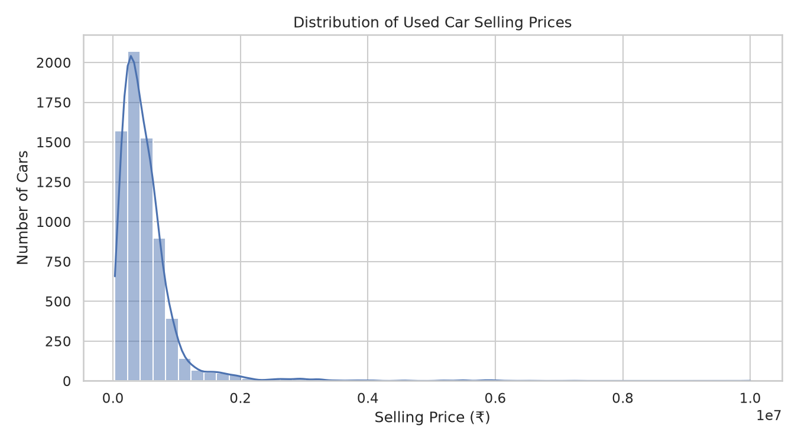
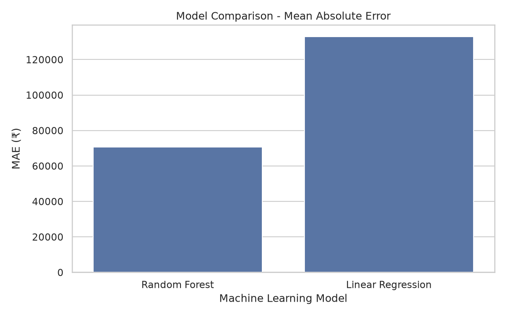
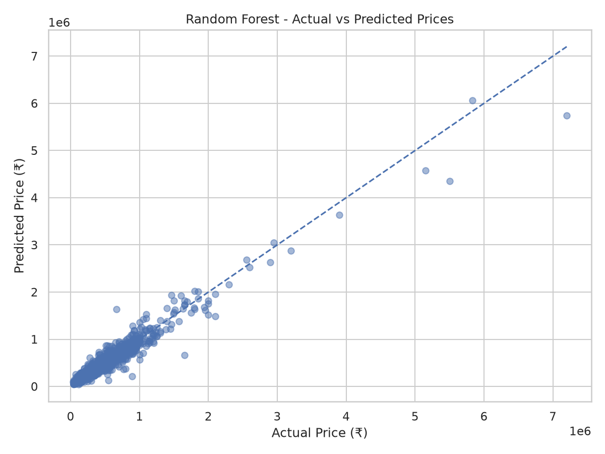

# Oasis Infobyte – Data Science Projects

A collection of Python-based Data Science and Machine Learning projects developed in the OIBSIP repository.

These projects demonstrate practical experience in data cleaning, exploratory data analysis (EDA), data visualization, statistical analysis, machine learning, model evaluation, and prediction.

## Projects

### 1. Iris Flower Classification

**Type:** Machine Learning – Classification

Classifies Iris flowers into Setosa, Versicolor, and Virginica using four physical measurements.

**Work completed:**
- Exploratory Data Analysis and visualizations
- Correlation analysis
- Logistic Regression, KNN, and Random Forest comparison
- Stratified 5-fold cross-validation
- Model evaluation and prediction using a saved pipeline

**Results:**
- Best mean cross-validation accuracy: 95.83%
- Selected model: Logistic Regression
- Final test accuracy: 93.33%

**Technologies:** Python, NumPy, Pandas, Matplotlib, Seaborn, Scikit-learn, Joblib.

[View Iris Flower Classification Project](DataScience-Task1-IrisFlowerClassification/)

**Visualizations**





---

### 2. Unemployment Analysis in India

**Type:** Data Analysis – Exploratory Data Analysis

Analyzes unemployment patterns across Indian states and examines monthly trends, rural and urban differences, and changes during the initial COVID-19 period.

**Work completed:**
- Data inspection and cleaning
- State-wise unemployment analysis
- Monthly trend analysis
- Rural vs. urban comparison
- Correlation analysis
- Pre-COVID vs. initial COVID-period comparison

**Selected findings:**
- Monthly unemployment averages increased sharply in April and May 2020 in Dataset B.
- Haryana, Tripura, and Jharkhand had the highest state-wise average unemployment rates in Dataset B.
- Rural and urban observations showed differences in average unemployment rates.

**Technologies:** Python, Pandas, NumPy, Matplotlib, Seaborn, Jupyter Notebook.

[View Unemployment Analysis Project](DataScience-Task2-UnemploymentAnalysis/)

**Visualizations**







---

### 3. Car Price Prediction

**Type:** Machine Learning – Regression

Builds a machine learning model to estimate used-car selling prices using historical CarDekho data.

**Work completed:**
- Dataset cleaning and duplicate removal
- Exploratory Data Analysis
- Feature engineering
- Regression model training and comparison
- Model evaluation and persistence
- Standalone price prediction

**Dataset:**
- Original records: 8,128
- Records after duplicate removal: 6,926
- Prediction target: Selling price

**Model comparison:**

| Model | MAE (₹) | RMSE (₹) | R² |
|---|---:|---:|---:|
| Random Forest | 70,780.51 | 116,786.50 | 0.9378 |
| Linear Regression | 132,937.49 | 261,730.89 | 0.6877 |

Random Forest was selected based on its stronger test-set performance.

**Technologies:** Python, Pandas, NumPy, Matplotlib, Seaborn, Scikit-learn, Joblib, Jupyter Notebook.

[View Car Price Prediction Project](DataScience-Task3-CarPricePrediction/)

**Visualizations**







---

## Skills Demonstrated

- Python programming
- Data cleaning and preprocessing
- Exploratory Data Analysis (EDA)
- Data visualization
- Statistical and correlation analysis
- Classification and regression
- Model comparison and evaluation
- Cross-validation
- Feature engineering
- Model serialization and prediction

## Repository Structure

```text
OIBSIP/
├── DataScience-Task1-IrisFlowerClassification/
├── DataScience-Task2-UnemploymentAnalysis/
├── DataScience-Task3-CarPricePrediction/
└── README.md
```

Each project folder contains its own documentation, source files, datasets or model artifacts, and visualizations where applicable.

## Author

**Rohaan S.**

- GitHub: [rohaansuresh123](https://github.com/rohaansuresh123)
- LinkedIn: [Rohaan S.](https://www.linkedin.com/in/rohaan-s-1a917123b)
- Portfolio: [rohaan-s-portfolio](https://rohaan-s-portfolio.vercel.app/)

---

*Built with Python, data analysis, and machine learning.*
